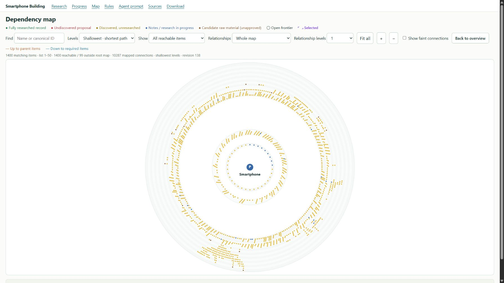

# Smartphone Research Map

**An educational investigation into the industrial world hidden inside an everyday object: what would it take to build a smartphone from scratch?**

I imagined a knowledgeable group starting on an Earth untouched by humans, with no manufactured tools, prepared materials, factories or utilities. Making a phone means making its parts, making the tools that make those parts, and following those dependencies back toward raw resources. The purpose is to learn how modern technology and industry fit together.

I built a shared research registry and an interactive map so this growing investigation could be explored, checked and extended. Follow an item such as copper wire to see proposed making routes, prerequisites, uses, evidence and unresolved questions. The companion [Smartphone Prototype Lab](https://github.com/kobinkempe/smartphone-prototype-lab) explores how that kind of information could become an engaging visual learning experience.

## Public demo

[Open the live demo](https://kobinkempe.pages.dev/smartphone-research-map/) · [Read the case study](https://kobinkempe.pages.dev/case-studies/smartphone-research-map/)



## Why this is more than a visualization

The hard part is preserving meaning as many research contributions accumulate. Canonical IDs, explicit making routes, source provenance, review states and a conservative graph gate keep the map tied to inspectable data. The map is generated from the same validated registry as the reading pages.

The revision-138 snapshot contains **1,507 records**, **825 candidate routes**, and **734 selected routes**. It still reports **zero closed manufacturing paths**. Most physical outputs remain discovery hypotheses. Structural validity and a visually connected path do not prove capability, completeness or physical feasibility.

## My role and the role of AI

I set the educational question, the meaning of the relationships, the review criteria and the direction of the experience. AI agents helped discover dependencies, research focused questions, critique proposals and implement the software. A shared data contract lets contributions accumulate as one investigation.

The software checks references, revisions and dependency cycles before publishing the map and reading pages. Those checks keep the research organized; evidence and review are still needed to establish whether a proposed manufacturing route would work. The current snapshot is an open investigation with many hypotheses.

## Run from source

Python 3.10+; core scripts use the standard library. Node.js is needed for JavaScript-driven layout/control tests.

```sh
python -B scripts/build_pages.py
python -m http.server 8000 --bind 127.0.0.1 --directory dist
```

Open http://127.0.0.1:8000/map.html. Start with a named item, inspect its dependencies and uses, and compare relationship/path controls. The generated `dist/smartphone-research.html` is an offline reading edition. Generated sites are excluded from Git; build them from the registry.

## The workflow

1. Discovery agents propose immediate making inventories and reuse existing canonical items.
2. The shared add operation normalizes proposals and checks every selected scenario.
3. Atomic revision updates reject cycles, dangling references and stale assumptions without partial publication.
4. Bounded research and independent review attach explicit maturity states and hash-bound evidence artifacts.
5. The renderer rebuilds maps and reading pages, checking dependency links against the validated graph.
6. A human inspects gaps and evidence and guides the next research or interaction experiment.

Read [the full workflow](docs/WORKFLOW.md), [graph gate contract](graph-gate-readme.md), [shared add API](docs/map-add-api.md), and [snapshot scope](SOURCE_SCOPE.md). The companion [prototype lab](https://github.com/kobinkempe/smartphone-prototype-lab) compares six learning interactions; it is not yet automatically driven by this registry.

## Validate

```sh
python -B -m unittest discover -s scripts -p "test_*.py"
python -B scripts/build_pages.py
python -B scripts/check_publication.py
```

The suite covers adversarial graph updates, lifecycle/publication checks and Node-driven map geometry/control checks. The publication audit checks all generated page links, selected dependency destinations, registered evidence hashes and the compressed standalone reading edition. The `out/` folder is a size-checked hosted edition; no hosting account configuration is needed to build or audit it. These tests establish software properties, not the truth of research flags or manufacturing claims.

## Data and source scope

The repo includes 44 registered evidence/source artifacts, authoring code and prompts. Raw chat logs, unregistered scratch proposals, local deployment state and original working-project Git history are excluded. The UI consumes local generated data; it does not call a model. Future research execution depends on the chosen agent environment. Research sources remain attributed in the registry and reports; inherited source links are marked where they have not been independently verified.
