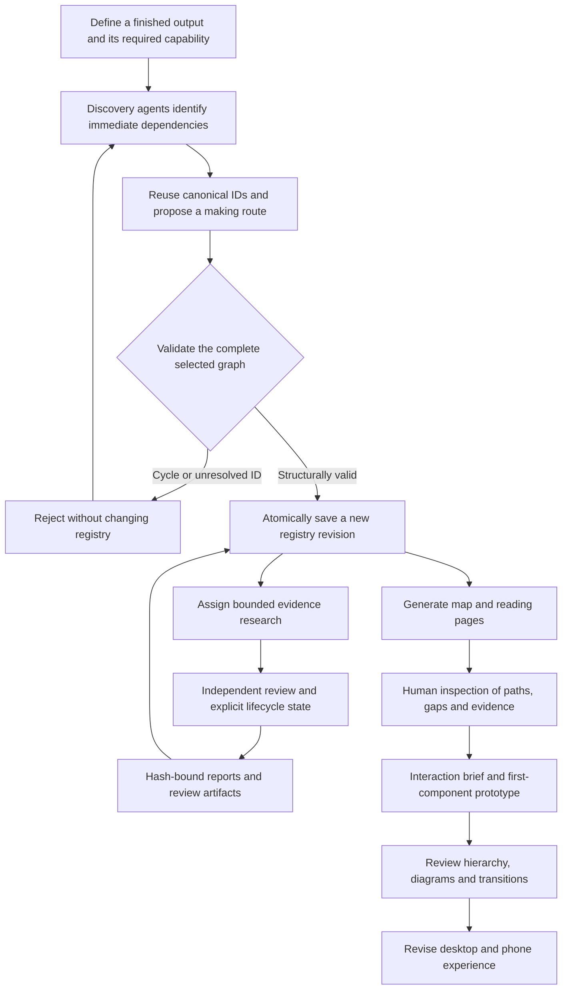

# From research question to map and prototype

The product question is how to explain the chain from a finished smartphone to the parts, tools, materials and knowledge needed to make it. The work has two connected streams: structured research with an inspectable map, and interface prototypes exploring how a learner follows that structure. They remain separate implementations.

## 1. Define outputs and relationships precisely

The registry distinguishes physical outputs and their making routes. Selected dependencies are output → selected route → required output. A part becomes part of the result; a tool is used to make or test it. Navigation links and backlinks are not manufacturing prerequisites. Keeping these meanings separate prevents an attractive diagram from silently inventing a recipe.

## 2. Discover broadly, research narrowly

Discovery agents receive canonical names and bounded contexts from `agent_context.py` and the tool-name bank. They should reuse existing IDs and explain new ones. Compact proposals go through `add_discovery.py`; accepted additions are still unreviewed hypotheses. The coordinator spots gaps, handles ambiguous reuse and assigns deeper evidence research. Research prompts request sources, target-level requirements, unknowns and capability demands rather than a confident generic summary.

## 3. Gate mutations at the shared boundary

`graph_gate.py` validates references, duplicate IDs/keys, selected routes and cycles across every scenario. Revisions and file locks serialize cooperating writers. A proposal that is valid by itself can still fail when combined with another agent's accepted changes. Rejected or stale proposals leave canonical bytes unchanged. This protects shared state while allowing multiple research agents to contribute.

The gate is conservative about closure. A declared DAG does not establish physical feasibility. Missing specifications, unknown capabilities, unreviewed compatibility and incomplete inventories keep closure false. A natural-resource endpoint needs explicit review and evidence. Review flags themselves still require honest human or independent review; code cannot prove their truth.

## 4. Preserve evidence without inflating maturity

Reports and review artifacts are registered with SHA-256 hashes and, where present, immutable snapshots. The renderer checks those files before publishing them. Assigned, started, paused, draft, reviewed and complete are explicit states; a research draft does not become a manufacturing demonstration because it has a source link.

## 5. Generate views from the same source

`build_pages.py` validates before generating the interactive map, item pages and standalone reading edition. Publication checks compare generated dependency links with the selected graph. The map uses browser interaction for finding an item, inspecting prerequisites/uses, highlighting paths, and comparing shallowest/deepest placement. Dots, layout and controls present declared relationships; they do not certify research completeness.

## 6. Test learning interactions separately

The prototype stream compares encyclopedia, animation, scroll, zoom, spatial canvas and stack approaches around shared speaker/coil/wire examples. Persistent ancestry, clear Part/Tool roles, changing child diagrams, and restoration of the caller's step are central review questions. Some content is a marked stand-in. The newer Zoom experience uses Three.js and gesture-based navigation; other experiments use SVG and DOM animation. The encyclopedia includes generated conceptual artwork with documented provenance.

## Current evidence and open work

The portfolio registry is revision 138: 1,507 total records, 1,499 physical outputs and eight software-boundary records; 825 candidate routes, 734 selected routes and 11,345 dependency edges. Its generated audit reports 1,469 discovered physical outputs, 16 research drafts, ten inherited pages and four reviewed outputs. It reports **zero natural endpoints and zero closed paths**. These are snapshot counts, not progress estimates or validated manufacturing instructions.

The copied code passes its 79 Python tests, including Node-driven map/control checks, and rebuilds its generated views. The full research and interface combination has no measured learning-outcome study, completeness guarantee or verified physical manufacture. Next work should qualify a small end-to-end branch, evaluate the learning journeys with users, and connect a prototype directly to a versioned registry contract before scaling the encyclopedia.

## Human and AI contributions

The human set the product goal, interaction constraints, review criteria and design direction. Agents supported discovery, bounded research, independent critiques, implementation and iteration. Deterministic programs enforce the structural contract and publication consistency. This is an agent-assisted research and software workflow, not a trained model or a claim that language-model output is reliable without checks.
